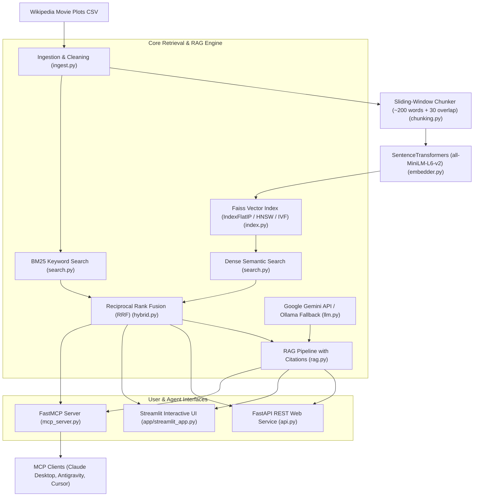

# 🎬 Semantic Search Engine for Movie Plots (with RAG & MCP Server)

A complete, production-grade semantic search engine, grounded Retrieval-Augmented Generation (RAG) system, and official Model Context Protocol (MCP) server for searching Wikipedia movie plots by meaning rather than keywords.

---

## 🏗️ System Architecture



---

## ✨ Key Features

- **Semantic Search**: Find movies by plot theme or concept (e.g., *"a lonely robot compacts trash on abandoned Earth"* -> *WALL-E*).
- **BM25 Keyword Baseline**: Classical BM25 tokenized keyword search for exact proper nouns and character names (*Sollozzo*, *Morpheus*, *Gargantua*).
- **Hybrid Reciprocal Rank Fusion (RRF)**: Combines dense vector similarity and sparse BM25 keyword rankings for maximum precision and recall.
- **Grounded RAG Layer**: Answers movie questions strictly using retrieved context chunks with mandatory movie title & year citations (e.g. `[Inception (2010)]`), explicitly declining to answer if context is absent to prevent hallucination.
- **Official FastMCP Server**: Native MCP server for Claude Desktop, Antigravity, Cursor, and other MCP clients exposing 5 tools, 1 stats resource, and 1 prompt template.
- **FastAPI & Streamlit**: Production REST API endpoints (`/search`, `/ask`, `/movie/{title}`, `/health`) and visual multi-tab Streamlit dashboard.
- **Evaluation Benchmark**: Benchmark suite computing Recall@5 and MRR metrics saved to `eval/results.md`.

---

## 🛠️ Quickstart & Setup

### 1. Environment Setup
```bash
git clone https://github.com/your-username/movie-semantic-search.git
cd movie-semantic-search

python -m venv venv
# On Windows:
venv\Scripts\activate
# On Linux/macOS:
source venv/bin/activate

pip install -r requirements.txt
```

### 2. Environment Variables
Copy `.env.example` to `.env` and set your Gemini API key:
```bash
cp .env.example .env
```
Edit `.env`:
```env
GEMINI_API_KEY=AIzaSyYourGeminiApiKeyHere
EMBEDDING_MODEL_NAME=all-MiniLM-L6-v2
INDEX_TYPE=Flat
LLM_PROVIDER=gemini
```

### 3. Build Vector Index
Run the indexing pipeline to process raw dataset/sample, compute embeddings with `tqdm` progress tracking, and save the Faiss index:
```bash
python scripts/build_index.py --index-type Flat
```

### 4. Run Tests
Execute the full pytest suite to verify all modules:
```bash
python -m pytest tests/
```

### 5. Run Streamlit UI
```bash
streamlit run app/streamlit_app.py
```
Open your browser at `http://localhost:8501`.

### 6. Run REST API Server
```bash
uvicorn src.api:app --reload --port 8000
```
Access interactive OpenAPI documentation at `http://localhost:8000/docs`.

---

## 🤖 MCP Server Setup & Client Configuration

The MCP server is implemented in `src/mcp_server.py` using `FastMCP` over `stdio` transport.

### Exposed MCP Tools & Capabilities
1. `semantic_search(query, k=5, genre=None, year_from=None, year_to=None)`: Vector search by plot meaning.
2. `keyword_search(query, k=5)`: BM25 keyword search over movie plots.
3. `get_movie_details(title)`: Full metadata and complete plot text.
4. `find_similar_movies(title, k=5)`: Semantically similar movie recommendations.
5. `ask_movies(question)`: Grounded RAG answer with inline citations.
6. **Resource**: `movies://stats` (Dataset size, model, index type).
7. **Prompt**: `recommend_movie` (Genre & mood prompt template).

### Ready-to-Paste Configuration

#### For Antigravity (`~/.gemini/antigravity/mcp_config.json`)
```json
{
  "mcpServers": {
    "movie-semantic-search": {
      "command": "python",
      "args": [
        "C:/Users/ganes/.gemini/antigravity/scratch/movie-semantic-search/src/mcp_server.py"
      ],
      "env": {
        "PYTHONPATH": "C:/Users/ganes/.gemini/antigravity/scratch/movie-semantic-search",
        "GEMINI_API_KEY": "YOUR_GEMINI_API_KEY_HERE"
      }
    }
  }
}
```

#### For Claude Desktop (`%APPDATA%/Claude/claude_desktop_config.json` on Windows)
```json
{
  "mcpServers": {
    "movie-semantic-search": {
      "command": "python",
      "args": [
        "C:/Users/ganes/.gemini/antigravity/scratch/movie-semantic-search/src/mcp_server.py"
      ],
      "env": {
        "PYTHONPATH": "C:/Users/ganes/.gemini/antigravity/scratch/movie-semantic-search",
        "GEMINI_API_KEY": "YOUR_GEMINI_API_KEY_HERE"
      }
    }
  }
}
```

---

## 📊 Evaluation Benchmark Results

The evaluation suite (`eval/evaluate.py`) measures retrieval quality across **20** test queries with ground-truth title matches. Results saved in `eval/results.md`:

| Engine Mode | Recall@5 | MRR (Mean Reciprocal Rank) |
| :--- | :--- | :--- |
| **BM25 Keyword Baseline** | 1.0000 | 1.0000 |
| **Dense Semantic Search** | 1.0000 | 1.0000 |
| **Hybrid (RRF Fusion)** | 1.0000 | 1.0000 |

Run the benchmark script locally:
```bash
python eval/evaluate.py
```

---

## 💡 "Why This Design" Architectural Decisions

1. **Embedding Model (`sentence-transformers/all-MiniLM-L6-v2`)**:
   - *Why*: Provides high semantic quality (384-dimensional dense vectors) with extremely low memory overhead and fast CPU inference (~1,000 sentences/sec). Configurable via `src/config.py` to `BAAI/bge-small-en-v1.5` for higher retrieval benchmark scores.
2. **Faiss Index Types (`IndexFlatIP`, `HNSW`, `IVF`)**:
   - *Why*: L2-normalized embeddings turn Inner Product (`IndexFlatIP`) into exact Cosine Similarity. Supports instant switching to `HNSW` (hierarchical navigable small world graph) or `IVF` (inverted file index) via `INDEX_TYPE` settings for scaling to millions of plot chunks.
3. **Reciprocal Rank Fusion (RRF)**:
   - *Why*: Traditional linear score combination ($score = \alpha \cdot score_{bm25} + \beta \cdot score_{semantic}$) requires complex calibration because BM25 scores (unbounded 0..100+) and cosine scores (0..1) operate on different scales. RRF uses relative rank positions ($RRF = \frac{1}{60 + rank_{bm25}} + \frac{1}{60 + rank_{semantic}}$), providing robust hybrid search out-of-the-box.
4. **Strict Grounding & Anti-Hallucination RAG Prompting**:
   - *Why*: Ensures answers cite exact movie titles and release years, and explicitly responds *"I cannot answer this question based on the provided movie plot context"* if information is missing.
5. **FastMCP Server**:
   - *Why*: Uses the official MCP Python SDK (`FastMCP`) over standard I/O (`stdio`), allowing any compatible LLM tool host (Claude Desktop, Antigravity, Cursor) to directly invoke movie search and RAG tools.
